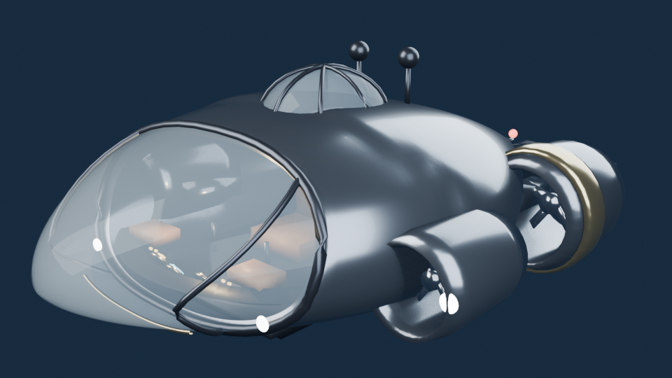

# BATHYS — MK-IV Abyssal

A cinematic, real-time 3D interactive web experience for **BATHYS**, a 4,000-meter piloted deep-sea exploration submersible, built with **Blender 5.1**, **Three.js**, **TypeScript**, **Vite**, and procedural **Web Audio**.

**Live Demo:** https://ahmedalighori.github.io/bathys/



---

## Features

- **Engraved Depth Gauge Loader**: Custom SVG pressure gauge whose needle tracks real `.glb` asset loading progress from `0 M` to `4,000 M`.
- **Opening Illumination Reveal**: Opens in total abyssal darkness with BATHYS centered in a circular pool of light. Clicking the submersible switches on its headlamps, fires a tactile switch + underwater swell, and expands a soft blue glow across the rocky seabed, marine snow, and distant ridges.
- **Three Continuous Scroll-Driven Camera Moves**:
  1. Arcs around the nose and settles directly in front of the panoramic acrylic viewport.
  2. Rises over the roof and top observation cupola, descending to the opposite flank.
  3. Sweeps beneath the hull and around the stern into the rear chase camera facing the open ocean.
  - Between moves, supports click-and-drag orbit and smooth cursor parallax, starting every transition continuously from the visitor's current viewpoint.
- **Playable Underwater Exploration**:
  - `W` — Move forward with gradual acceleration and underwater inertia
  - `A` / `D` — Smooth steering with subtle roll
  - `E` — Smoothly glide into pilot eye-level inside the cockpit and back to the rear chase camera while moving
  - **Functional Cockpit Instruments**: Live speed needle, heading compass dial, and a clickable dashboard headlight switch that toggles the exterior beams.
  - **Living Ocean & Shipwreck**: Three schooling fish species (silver-blue, muted gold, copper-red), a distant gliding shark, swaying olive seaweed, flexing violet sea fans, pink tube sponges, anemones, and a tilted steel shipwreck with exposed hull ribs and collision avoidance.
- **Procedural Web Audio Engine**: Zero external audio files—synthesizes seamless underwater ambience, a restrained ambient harmonic pad, speed-linked thruster hum, directional camera sweeps, and a cockpit audio crossfade (muffled exterior + quiet pressurized cabin hum) with a persistent sound toggle.
- **Full-Screen Dive Archive & Footer**:
  - Triggered by a fresh fourth scroll gesture (ignoring leftover trackpad momentum) via a shrinking oval lens transition rimmed in soft champagne gold.
  - Features four logbook entries (*The Vessel*, *Inside the Cockpit*, *Marine Life*, *The Wreck*) with custom marine emblems, curved-glass hover swell and inner parallax, a dissolving cursor particle trail, field-note modals, touch swipe support, and a compact charcoal footer (`Return to ocean`, `Back to top`, and synced sound toggle).

---

## Project Structure

```text
Bathys/
├── .github/workflows/
│   └── deploy.yml                  # Automated GitHub Pages build & deploy
├── references/                     # 5 transparent Bathys PNG views + 9 marine/wreck refs
├── models/                         # Blender Python generators, bathys.blend & 10 GLB assets
│   ├── build_bathys.py             # Generates bathys.glb & 5 transparent reference views
│   ├── build_ocean_assets.py       # Generates 3 fish, shark, shipwreck & 4 flora GLBs
│   ├── upgrade_textures_and_refs.py# Embeds procedural textures & renders 9 asset refs
│   ├── render_archive_stills.py    # Renders clean underwater stills for Dive Archive
│   └── *.glb                       # Web-ready GLB models
└── web/                            # Vite + TypeScript + Three.js web application
    ├── public/
    │   ├── models/                 # Deployed .glb assets
    │   └── images/                 # Dive Archive entry imagery
    └── src/
        ├── main.ts                 # Stage choreography, scroll gating & oval transition
        ├── oceanScene.ts           # Three.js scene, physics, cockpit & marine life AI
        ├── archive.ts              # Dive Archive, curved-glass hover & particle trail
        ├── audio.ts                # Procedural Web Audio synthesizer & mixer
        └── style.css               # Engraved Copperplate/Cinzel UI & archive styling
```

---

## Local Development

### Run the Web App
```bash
cd web
npm install
npm run dev
```
Open `http://localhost:5173/` in your browser.

### Build for Production
```bash
cd web
npm run build
```

### Regenerate 3D Models (Optional, requires Blender 5.x)
```bash
blender --background --python models/build_bathys.py
blender --background --python models/build_ocean_assets.py
blender --background --python models/upgrade_textures_and_refs.py
blender --background --python models/render_archive_stills.py
```

---

## License

MIT
